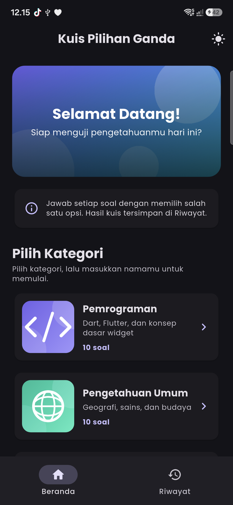
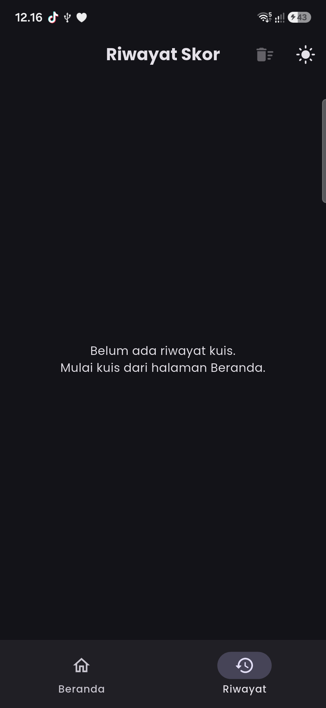
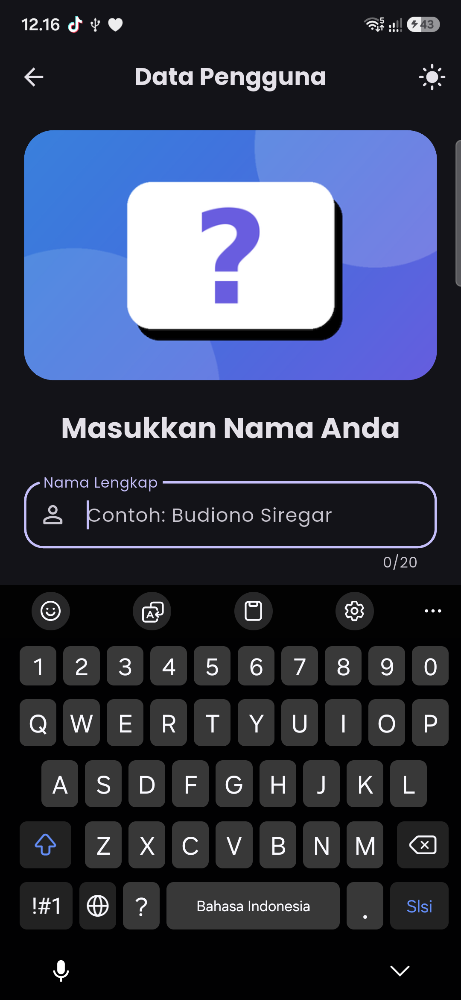
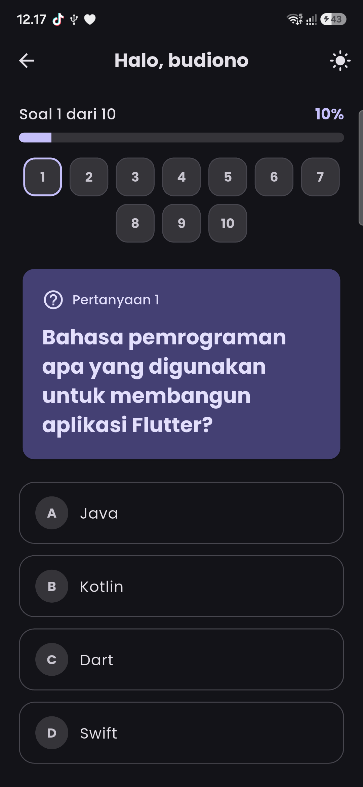
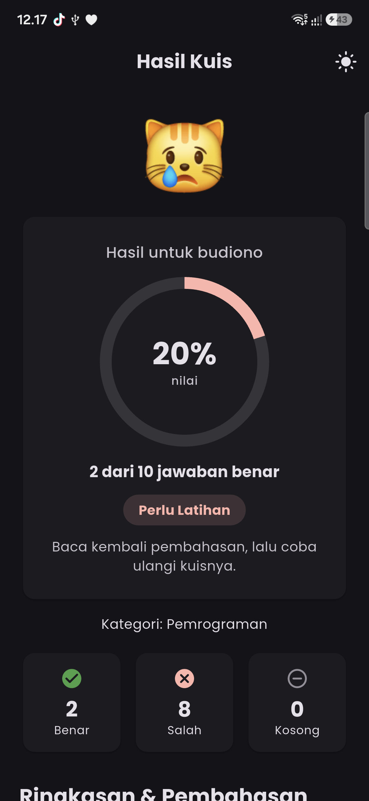
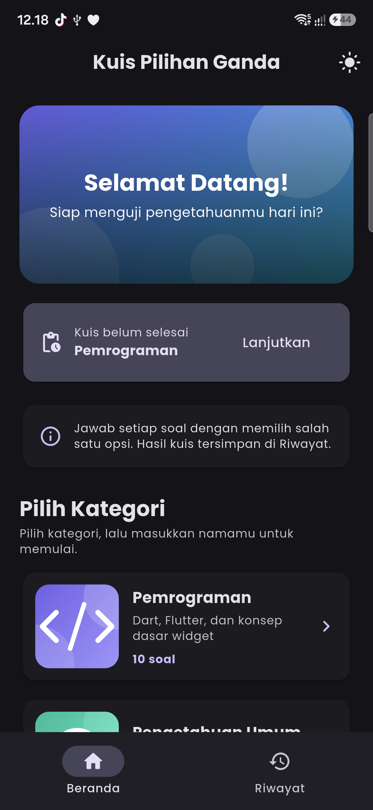

# Kuis Pilihan Ganda

Aplikasi kuis pilihan ganda berbasis Flutter untuk menguji pengetahuan di empat kategori: Pemrograman, Pengetahuan Umum, Matematika, dan Acak. Pengguna memilih kategori, memasukkan nama, lalu menjawab 10 soal. Setelah selesai, aplikasi menampilkan skor, jumlah jawaban benar dan salah, serta pembahasan setiap soal. Riwayat hasil kuis tersimpan dan kuis yang belum selesai bisa dilanjutkan.

## Identitas

| Keterangan | Isi |
|---|---|
| Nama | [isi nama lengkap] |
| NIM | [isi NIM] |
| Lab | [isi nama lab] |
| Mata Kuliah | Pemrograman Mobile |

## Screenshot

| Beranda | Riwayat |
|---|---|
|  |  |

| Input Nama | Kuis |
|---|---|
|  |  |

| Hasil | Lanjutkan Kuis |
|---|---|
|  |  |

## Fitur

- Navigasi bawah: Beranda dan Riwayat.
- Beranda: sapaan pengguna, info singkat, pilihan kategori, dan tombol mulai kuis.
- Kategori kuis: Pemrograman, Pengetahuan Umum, Matematika, dan Acak (campuran dari semua kategori). Setiap kategori berisi 10 soal.
- Kuis pilihan ganda dengan empat opsi (A, B, C, D) dan navigasi Sebelumnya / Lanjut.
- Indikator progres (nomor soal dan bar persentase).
- Halaman hasil: skor, jumlah benar, salah, dan kosong, serta pembahasan setiap soal.
- Riwayat skor, disimpan selama aplikasi berjalan.
- Lanjutkan kuis yang belum selesai dari kartu di Beranda.
- Ulangi kuis atau kembali ke halaman awal.
- State kuis tetap aman saat layar dirotasi atau berpindah halaman (Provider).
- Dual theme: mode terang dan gelap, dapat diganti langsung oleh pengguna.
- Layout responsif untuk HP, tablet, dan web view.
- Custom font Poppins dari aset lokal (`assets/fonts/`).
- Ilustrasi di setiap kategori dan layar input nama.
- Data soal dummy lokal (tanpa database eksternal).

## Credit Aset

- Ilustrasi kategori (`assets/images/cat_*.png`) dan banner layar nama
  (`assets/images/name_banner.png`): dibuat sendiri secara programatik untuk tugas ini.
- Banner beranda (`assets/images/quiz_banner.png`): dibuat sendiri secara programatik untuk tugas ini.
- Font Poppins: lisensi SIL Open Font License 1.1 (`assets/fonts/`).
- Ikon: Material Icons (bawaan Flutter).

## Getting Started

This project is a starting point for a Flutter application.

A few resources to get you started if this is your first Flutter project:

- [Learn Flutter](https://docs.flutter.dev/get-started/learn-flutter)
- [Write your first Flutter app](https://docs.flutter.dev/get-started/codelab)
- [Flutter learning resources](https://docs.flutter.dev/reference/learning-resources)

For help getting started with Flutter development, view the
[online documentation](https://docs.flutter.dev/), which offers tutorials,
samples, guidance on mobile development, and a full API reference.
